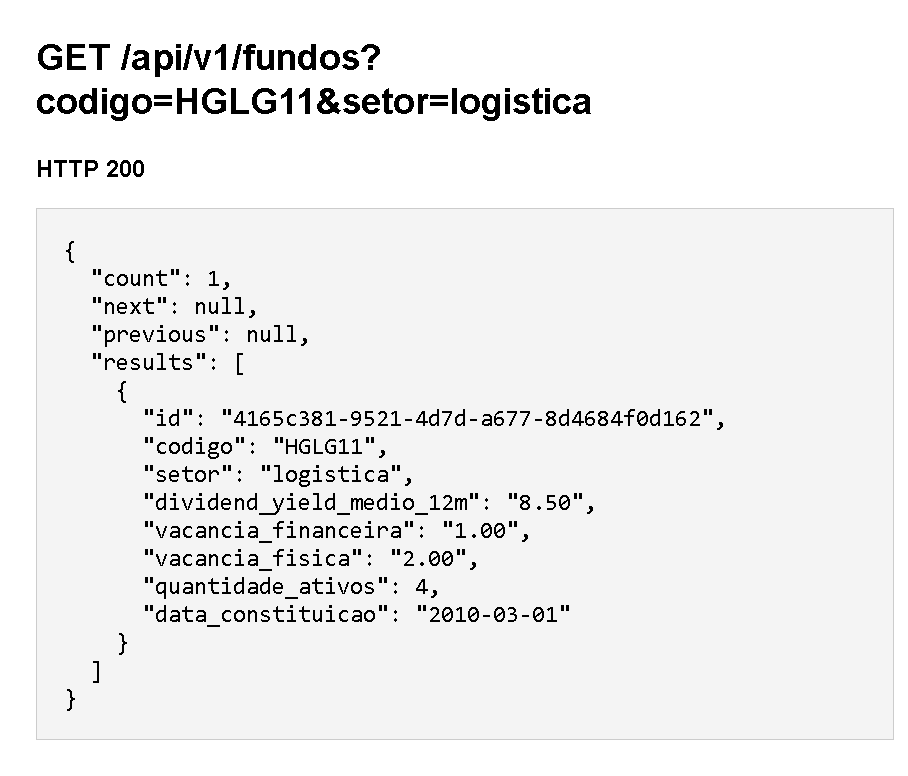
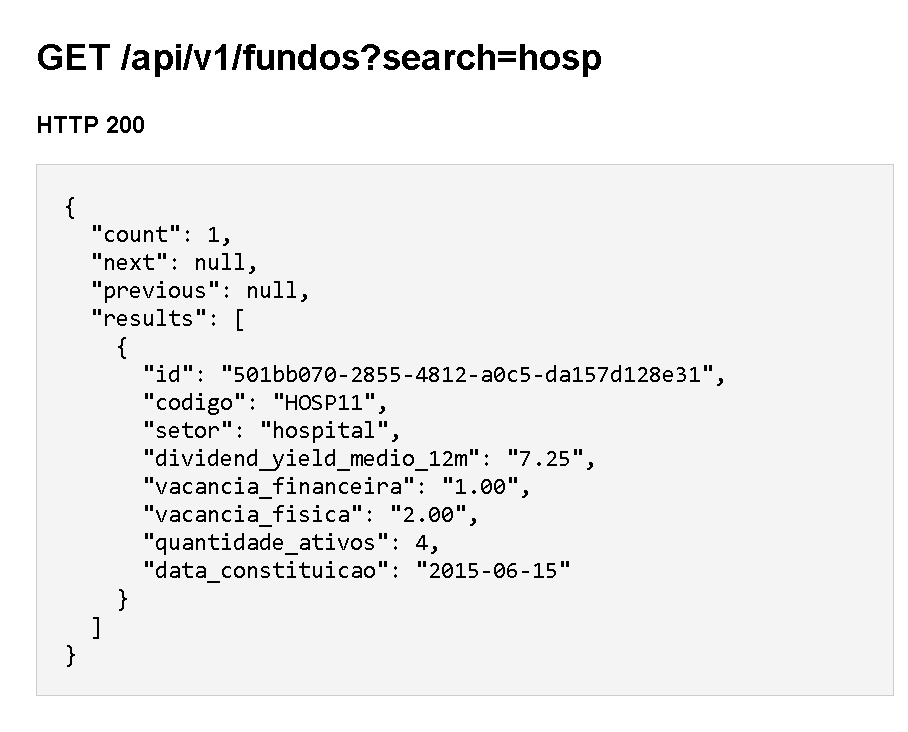
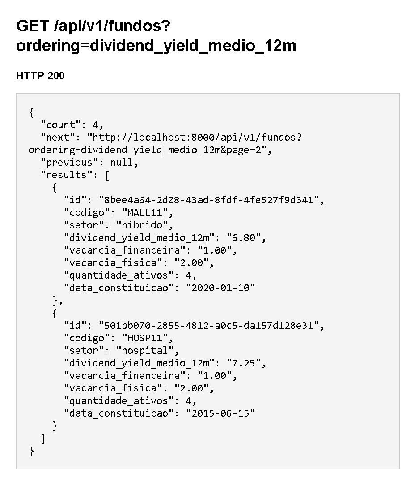
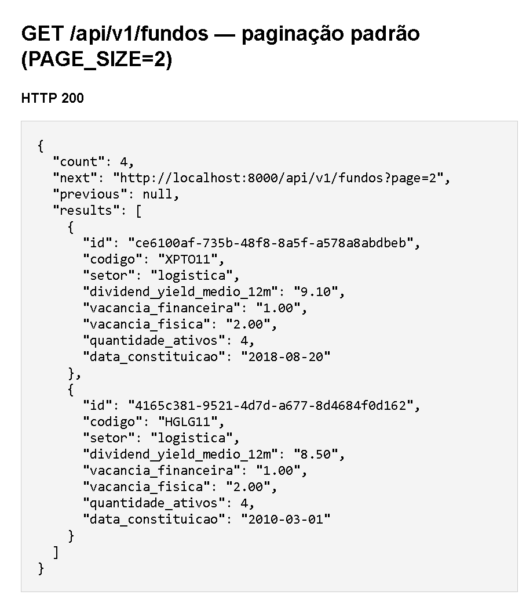
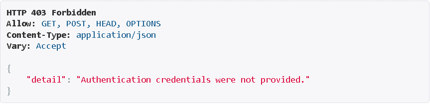
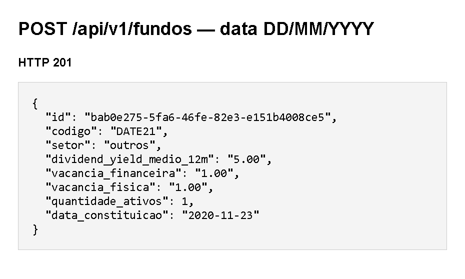
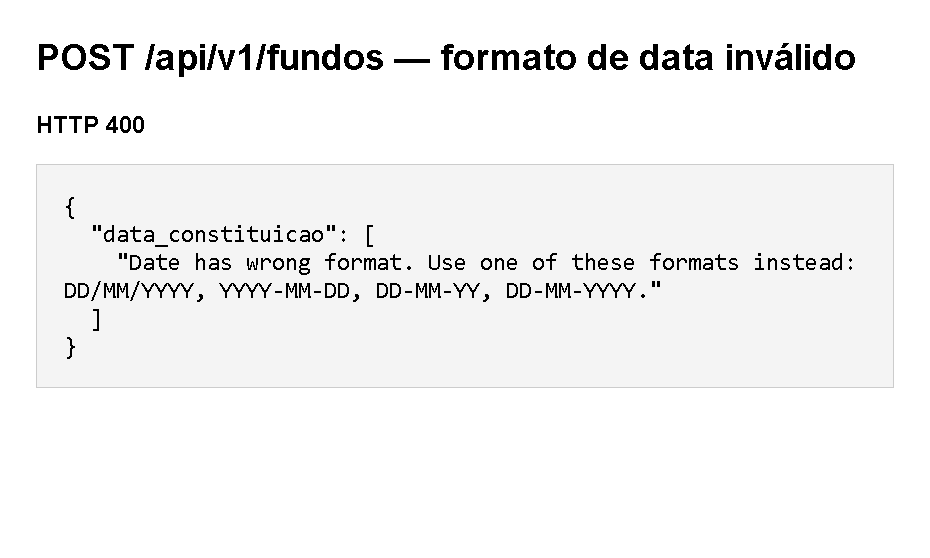

# fundsfinder

API REST para consulta de fundos imobiliários, desenvolvida com Django REST Framework.

**Repositório:** [PPI-TSI — branch `api-fundsfinder`](https://github.com/anacarenmartins315-lgtm/PPI-TSI/tree/api-fundsfinder)

## Executar localmente

```powershell
python -m venv .venv
.\.venv\Scripts\Activate.ps1
python -m pip install -r requirements.txt
python manage.py migrate
python manage.py createsuperuser
python manage.py runserver
```

O endpoint de coleção é `http://127.0.0.1:8000/api/v1/fundos`. A API requer autenticação; crie um usuário com `createsuperuser` ou pelo admin antes de fazer as requisições. A interface de navegação do DRF permite entrar pelo link **Log in** em `/api-auth/login/`.

## Filtros, busca e ordenação

A configuração está em `api/views.py`, no `FundoImobiliarioViewSet`:

- `DjangoFilterBackend` e `filterset_fields = ['codigo', 'setor']` habilitam filtros exatos combináveis, por exemplo `?codigo=HGLG11&setor=logistica`.
- `SearchFilter` e `search_fields = ['codigo', 'setor']` habilitam busca textual parcial, sem diferenciar maiúsculas de minúsculas, com o parâmetro `?search=`. Exemplo: `?search=hglg`.
- `OrderingFilter` e `ordering_fields` limitam a ordenação dinâmica aos campos declarados. Use `?ordering=setor` para crescente e `?ordering=-setor` para decrescente.
- `ordering = ['-dividend_yield_medio_12m']` define a ordenação padrão quando `ordering` não é enviado: maior dividend yield primeiro.

Exemplos de requisições autenticadas no PowerShell (substitua usuário e senha):

```powershell
curl.exe -u usuario:senha "http://127.0.0.1:8000/api/v1/fundos?codigo=HGLG11&setor=logistica"
curl.exe -u usuario:senha "http://127.0.0.1:8000/api/v1/fundos?search=hglg"
curl.exe -u usuario:senha "http://127.0.0.1:8000/api/v1/fundos?ordering=-setor"
```

## Paginação

Em `fundsfinder/settings.py`, `DEFAULT_PAGINATION_CLASS` está configurado como `PageNumberPagination` e `PAGE_SIZE = 2`. A resposta de coleção é envolvida por:

- `count`: total de objetos que correspondem à consulta;
- `next`: URL da próxima página, ou `null` quando não houver próxima página;
- `previous`: URL da página anterior, ou `null` na primeira página;
- `results`: objetos da página atual.

Use `?page=2` para consultar a segunda página. A paginação também se aplica aos resultados filtrados, pesquisados e ordenados.

## Autenticação e permissões

`REST_FRAMEWORK` em `fundsfinder/settings.py` declara `SessionAuthentication` e `BasicAuthentication` em `DEFAULT_AUTHENTICATION_CLASSES`. A autenticação por sessão é útil na interface navegável do DRF; a autenticação básica permite credenciais HTTP para testes e clientes simples (use HTTPS fora do ambiente local).

`DEFAULT_PERMISSION_CLASSES` usa `IsAuthenticated`, então endpoints protegidos exigem usuário autenticado por padrão. O `FundoImobiliarioViewSet` também declara `permission_classes = [IsAuthenticated]`: essa regra individual reforça explicitamente a proteção da View. Uma permissão declarada na View substitui a configuração global para aquela View, em vez de ser somada automaticamente a ela. Para tornar uma View pública, seria necessário declarar outra permissão nela, como `AllowAny`.

## Formatos de data

`DATE_INPUT_FORMATS` em `fundsfinder/settings.py` permite datas de entrada em `DD/MM/YYYY`, `YYYY-MM-DD`, `DD-MM-YY` e `DD-MM-YYYY`. O campo é serializado na resposta no formato ISO (`YYYY-MM-DD`). A configuração afeta a leitura das datas recebidas; ela não altera o formato padrão de saída.

## Testes automatizados

Os testes de `api/tests.py` cobrem filtros combinados, busca por código e setor, ordenação padrão e dinâmica, paginação, acesso autenticado e negado, e formatos aceitos/rejeitados de data:

```powershell
python manage.py test api
```

Os testes criam dados temporários no banco de teste e exercitam as requisições pelo cliente de testes do DRF; nenhum dado de teste é adicionado ao banco local.

## Capturas das requisições

As imagens em `evidencias/` registram respostas reais da API navegável, autenticadas quando necessário. Os dados usados nas capturas foram criados localmente para demonstração e não fazem parte das migrations.

**Filtro por código e setor** (`?codigo=HGLG11&setor=logistica`):



**Busca textual** (`?search=hosp`):



**Ordenação crescente** (`?ordering=dividend_yield_medio_12m`):



**Paginação padrão:** a captura mostra `count`, `next`, `previous` e `results`.



**Autenticação e permissão:** sem credenciais, a API nega o acesso.



**Formatos de data:** `DD/MM/YYYY` é aceito e normalizado para ISO; formato não configurado retorna HTTP 400.





## Respostas sobre os recursos da API REST

1. **Qual a diferença entre filtro e busca?** O filtro por `codigo` ou `setor` seleciona valores exatos de campos específicos. `search` procura texto parcialmente nos campos configurados em `search_fields`.
2. **Como ordenar os resultados?** Envie em `ordering` um campo permitido em `ordering_fields`; o prefixo `-` inverte para ordem decrescente. Sem o parâmetro, vale a ordenação padrão da View.
3. **Para que serve a paginação?** Divide listas grandes em páginas, limitando itens por resposta e fornecendo total e navegação (`count`, `next`, `previous`, `results`).
4. **Autenticação e permissão são a mesma coisa?** Não. Autenticação identifica o usuário (por sessão ou credenciais básicas); permissão decide se aquele usuário pode executar a operação. `IsAuthenticated` exige identidade autenticada.
5. **Como as permissões globais se relacionam às individuais?** As permissões globais são o padrão do DRF. Uma View pode declarar `permission_classes` próprio; essa declaração substitui o padrão para aquela View, permitindo reforçar ou alterar a política.

> A lista de requisitos recebida não inclui os enunciados literais das questões da atividade. As respostas acima atendem aos tópicos nela mencionados; compare-as com o enunciado original para ajustar a redação, se necessário.
